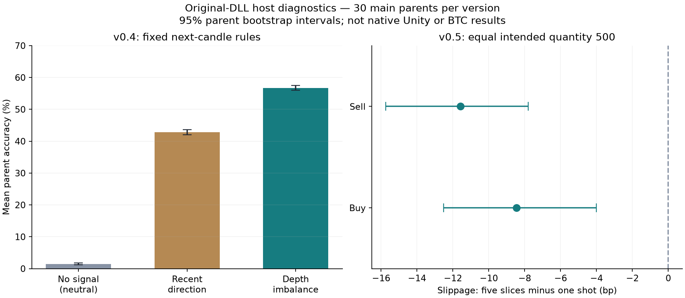

# Research review: extended experiments before model training

1 November 2026. No model fitting, trading or binary modification. The new experiments are **original-DLL CLR diagnostics outside Unity**, separate from the earlier native control observations. Native activation failed twice on this continuation (including refreshed selection); no new app inputs were sent. No fresh native screenshot/recording was obtained. This report does not mark the full native research request complete.

## Evidence and environment

- Existing evidence: 720 host scenarios/25,200 observations and separate native control pass. New evidence: 40 untouched v0.4 parents and 200 v0.5 scenarios from 40 parents. Ten pilot and thirty main parents per version. Sibling v0.5 conditions share a parent.
- v0.4 new raw records: 24,000 base-candle rows (100 warmup + 500 observed per parent; 20,000 post-warmup rows). v0.5 new raw records: 10,200 observations (51 per scenario). These counts include pilots; analysis uses separate phases. There are 80 new parent states, not 240 independent scenarios plus parents.
- Build identity: preserved Windows Assembly-CSharp SHA256 v0.4 `F1F99D934A6F8AE98360C931F90F8E1294E1B9384F5E914A2970F7C2B9FA8024`; v0.5 `067EB14F626E4E5B33A8BA9D2551A1B343246AB300F2D49635471F9604E4A56C`. Complete executable/player hashes remain in the existing evidence manifest and were rechecked.
- Native logs previously verify v0.4 Unity 6000.0.16f1 and v0.5 Unity 6000.3.17f1 on this PC; rendering and controls were observed previously. Host scene: 200 agents, maker/request .1, activity/sweep .1, drop/candle .1, starting price 10,000 raw cents, five sweeps/base candle. These are declared research settings, not extracted native scene parameters. Current native nominal lot 100 was separately observed; trader count, aggregation and retention remain unmeasured.
- Price unit raw cents; bp=10000*(future/reference−1). v0.4 volume is executed quantity from original code; it has no BTC calibration. v0.5 source volume weights player quantity 100x and source OHLC omits intratrade extremes, so the new v0.5 analysis uses last trade and exact cash/coin transfers, not those labels. A base candle is five agent sweeps, never automatically a minute.
- Protocols: PREREGISTRATION-B.md and PREREGISTRATION-C.md precede collection. No thresholds tuned using main outcomes. Mean intervals use 2,000 parent bootstrap samples. Multiple exploratory comparisons are not multiplicity-adjusted.

## v0.4: predefined observable-book rules

Main candidate origins: 14,100 (470 per parent, preserving 30 future candles). Locked/absent-book exclusions: 445. Common fixed-rule grid: 10168; the remaining valid origins lack measurable 10-bp depth and are excluded from the shared rule comparison. All outcomes are next completed base-candle last-trade direction, neutral within ±1 bp.

| Fixed rule | Origin-weighted accuracy | Balanced accuracy | Mean parent accuracy [95% CI] |
|---|---:|---:|---:|
| No signal: always neutral | 1.48% | 33.33% | 1.48 [1.17, 1.83]% |
| Previous candle direction | 42.87% | 29.87% | 42.87 [42.03, 43.68]% |
| 10-bp imbalance ±0.2 | 56.72% | 39.67% | 56.74 [55.99, 57.45]% |

Book minus recent-direction mean parent accuracy: 13.87 [12.81, 14.96] percentage points. This supports testing observable depth in this simulator. It does not establish real BTC forecast skill, calibrated entry odds or an incremental trained-model improvement. Missing-depth exclusions reduce coverage; the source's locked-book, quantity/removal artifacts and random anchoring can generate this association.

| Predetermined pattern stratum | Origins / parents | Book minus recent direction, pp [95% CI] |
|---|---:|---:|
| range | 5228 / 30 | 13.58 [12.10, 15.03] |
| triangle | 175 / 27 | 21.11 [6.25, 32.89] |
| flag | 181 / 28 | 7.72 [-7.62, 21.47] |

These compare fixed rules within pattern strata. They are not a candle-pattern classifier or a complete matched shape-only versus book ablation. In particular, the flag-stratum interval includes no benefit; no universal claim about patterns follows.

| Trailing-volume stratum | Origins / parents | Book minus recent direction, pp [95% CI] |
|---|---:|---:|
| low | 5374 / 30 | 17.52 [15.82, 19.31] |
| middle | 3869 / 30 | 10.65 [8.96, 12.36] |
| high | 925 / 30 | 5.67 [0.51, 10.94] |

Volume thresholds use only the prior100 completed candles. These strata do not identify a real session or isolate the three built-in sinusoidal quantity phases. Maker choice is per request; prior code finds triangular placement, not normal placement, and no individual order-aging clock. No real-world session timezone is inferred.

## v0.4: naturally persistent levels, failures and removal

A wall requires 5 sampled boundaries of persistence, within 10 bp, and quantity above the trailing 90th percentile. Weak levels use the trailing median cutoff. First eligible event per side/strength per parent only. Target/stop are ±10 bp from **origin**, not first-touch entries. Both barriers in one future OHLC candle remain ambiguous. Strong/weak events occur at different times; distance, volatility and volume are not matched. These are observational reaction diagnostics.

| Level group | Parents | Target / stop / ambiguous / timeout | Mean side-favorable 30-candle return bp [95% CI] |
|---|---:|---|---:|
| bid_strong | 29 | 16 / 1 / 12 / 0 | 141.46 [5.23, 290.67] |
| bid_weak | 30 | 10 / 0 / 20 / 0 | 12.38 [-140.89, 168.99] |
| ask_strong | 28 | 13 / 0 / 15 / 0 | -47.09 [-219.26, 114.73] |
| ask_weak | 30 | 11 / 0 / 19 / 0 | -32.08 [-206.99, 132.80] |

Across 30 main parents (including their 100 warmup boundaries), the recorder attributed 17,515 units / 1,709 changed levels to random-removal calls and 17,115 units / 1,696 changed levels to pruning. Random-removal events with pre-removal level quantity>30: 0. This supports the documented large-level exemption. Call provenance distinguishes these removals; ordinary sweep changes remain **net** changes, so individual fill sizes, gross refill and same-sweep disappear/reappear histories are unavailable.

Large-bid positive outcomes coexist with failed long-horizon cases; ask results do not show a symmetric favorable mean. Large within-candle ambiguity prevents turning target counts into an 80% entry probability. Level persistence is a history feature, not individual order age. Within-sweep persistence and causal history dependence remain unresolved.

| Candle proxy | Events / parents | Mean parent next-candle return bp [95% CI] |
|---|---:|---:|
| sweep_proxy | 298 / 30 | -8.98 [-21.32, 2.74] |
| absorption_candidate | 33 / 21 | 13.64 [-29.66, 53.77] |

Sweep proxy means high range plus high volume, not a verified single aggressive sweep. Absorption candidate means high volume, small body and low range, not known hidden reserve. Both next-return intervals cross zero. Net depth replenishment can be inspected in the raw changes; gross refill/execution decomposition needs finer event capture. No directional absorption edge is established.

## v0.5: equal total quantity, repeated interventions and recovery

New main comparisons: 30 parents × 5 conditions = 150 scenario identities. Untouched baseline plus buy/sell 500 at once or five 100-unit orders at base candles 0/5/10/15/20. All requested 500 units filled in every completed intervention scenario; no partial fills or execution errors occurred in this profile. Partial/zero-fill defects remain established by earlier fixtures, not removed by these successes. Warmup fingerprints matched baseline for every sibling. Exact per-order notional/quantity and all followup horizons are retained.

| Condition | Main parents | Mean total slippage bp [95% CI] | First→last 100-unit impact, bp | Censored half-impact recovery /30 |
|---|---:|---:|---|---:|
| buy_one500 | 30 | 78.43 [74.68, 82.37] | single 500-unit order | 28 |
| sell_one500 | 30 | 74.65 [69.54, 79.57] | single 500-unit order | 25 |
| buy_repeat100 | 30 | 69.97 [64.80, 76.09] | 35.51→32.57 | 12 |
| sell_repeat100 | 30 | 63.06 [56.91, 68.69] | 33.29→31.63 | 6 |

| Paired repeated-minus-one-shot contrast | Slippage bp [95% CI]; negative is cheaper | Common-origin +50 return difference bp [95% CI] |
|---|---:|---:|
| buy | -8.46 [-12.51, -4.01] | -28.84 [-34.34, -23.02] |
| sell | -11.59 [-15.73, -7.80] | 31.80 [22.64, 40.00] |

The larger 500-unit study supports cheaper average execution for this five-slice schedule in this profile. Earlier equal-total 10-unit tests had intervals including zero; the new result does not overturn those smaller-size findings or establish a universal schedule. Time exposure differs: the final repeated order is 20 candles after origin. Full results report both common-origin and last-fill horizons. No fee or opportunity-cost model is included.

Last-minus-first 100-unit impact: buy -2.94 [-6.31, 0.24]bp; sell -1.66 [-4.87, 1.63]bp. Both intervals include zero. This does not establish systematic weakening/strengthening or identify inventory as the cause. Recovery is measured relative to the **last order's own arrival and impact**, censored at30 candles. One-shot and repeated final-order recovery involve different quantities and elapsed time and are not a fair efficacy comparison.

Ordinary untouched main baselines ended with negative-cash agents in 7/30 parents and negative-coin agents in 3/30; categories may overlap. All 200 pilot + main scenarios passed synchronous player-transfer and ordinary-only conservation checks at every recorded boundary. Aggregate conservation coexists with invalid individual collateral. Neither finite initial balances nor conserved totals establish a realistic closed economy under unlimited-player interventions.

Existing round-trip evidence remains separate: exact-ledger size 10 main buy/sell roundtrips had negative mean cash PnL, with buy uncertainty including zero. New 500-unit tests did not unwind; favorable movement is not realized profit. Native display PnL is quantity-defective and cannot substitute for either ledger.

## Data dictionary and export verdict

| Field family | Availability | Valid use / restriction |
|---|---|---|
| OHLC/base volume | Numeric host v0.4; visual native only | Source artifacts persist; no minute/BTC calibration |
| Last-trade returns at1/5/15/30 | Numeric in both hosts | Future labels only; no future feature leakage |
| bids/asks price–quantity boundary arrays | Numeric diagnostic host | Recompute totals; reject crossed/absent books; real-feed observable analog |
| Level persistence/distance | Boundary-array derived | Causal observable feature, not individual age or identity |
| cause-tagged net changes | Host wrapper call provenance | Random/pruning exact; agent-sweep net only; not native export |
| Volume/shape absorption or sweep proxy | Prior/current completed candles | Hypothesis only; cannot expose hidden quantity or participant |
| Intended, filled, notional, VWAP, arrival | Synchronous v0.5 host ledger | Actual transfers; include partial/zero-fill failures; no fee inferred |
| Agent cash/coins/negative balances, RNG | Simulator-only | Diagnostic/oracle only; exclude deployable predictor |
| Individual order IDs, age, cancellations, gross refill | Unavailable here | Do not fabricate from net bars |
| Exchange timestamps, funding, news, hidden reserves, liquidations | Unavailable in these experiments | No invented labels or live-minute mapping |

No supported native numeric export, seed UI, complete replay or headless interface has been verified. v0.5 backup throws in isolated original methods; both snapshots omit sufficient state/RNG. Reinitializing seeded host objects supplies paired research states; it is not app restore. The new host records improve diagnostic coverage but are **not certified training records**. Full serialized scene parameters remain unavailable. Current visual recordings can measure displayed price/PnL/nominal position and approximate geometry, not exact fills/depth/event causes.

## Research-to-model changes and review proposal

| Previous assumption | Evidence | Revised decision |
|---|---|---|
| Shape alone describes the next candle | Fixed imbalance beats recent direction in this host; flag result uncertain | Compare candles-only, book-added, book+executions on identical real held-out origins; no claimed real advantage |
| Persistent wall means reliable support/resistance | Failed long paths, ambiguous barriers, removal exemption | Keep distance/persistence with uncertainty; test source-rule sensitivity; no 80% entry label |
| High-volume wick identifies absorption/whale |33 candidates across 21 parents; return interval crosses zero | Treat as observable proxy only; require signed trades and gross refill before causal interpretation |
| Small and large execution schedules behave alike | Larger 500 unit slicing contrast differs from earlier 10 unit inconclusive result | Include size/depth and schedule interactions; test unseen sizes and parameter families |
| Repeated impact necessarily weakens as agents deplete | First-last intervals include zero; collateral invalid | No enforced exhaustion/recovery assumption; independently validate reservations and balances |
| Native lot equals code initializer 10 | Prior native panel confirms nominal 100 | Separate scene overrides from host configuration and physical achieved quantity |
| Better simulator direction score means profitable BTC entries | No real-market or cost-aware entry test; source defects | Retain simple baselines and train/evaluate only after separate review and data validation |

Retain the 1,440 completed-minute context and MLP/sequence comparisons as independent design proposals, not verified Tiger architecture. No model has been fitted in this work. A corrected independent event engine needs equality/FIFO, collateral, cancel-unlock, zero/partial fill, per-trade OHLC/volume and full-state/RNG tests before synthetic pretraining. Calibrate only from training-period real observations.

Split synthetic data by whole parent and scenario family, keeping all windows/siblings together; hold out sizes/settings. Fit normalizers on training data only. Compare real-only against synthetic-pretrained on the same untouched real BTCUSDT perpetual test. Simulator-only portfolios/RNG remain oracle diagnostics. Proposed real data periods and acquisition gates remain in the frozen protocol.

| Evaluation panel | Required computation |
|---|---|
| Training | Fitted origins only; separate synthetic/real; loss and component errors; not generalization |
| Past unseen | Frozen chronological real test after validation/calibration; USDT MAE/RMSE, MSE in USDT², bp=10000*error/origin; component OHLC/base-volume; strongest fixed-direction/last-close baselines |
| Recent real-market | Only matured immutable real forward predictions; 24h plus 7-day context; pending/late/gapped counts; no simulator segment relabeled as live |
| Probability/interval | Proper log/Brier loss; 50/80/90% coverage and width; reliability with denominators; no accuracy conversion from MSE |
| Entry | Target-before-stop within fixed expiry; timeouts, ambiguous sides, coverage; realized cash/achieved quantity; executable bid/ask, latency, fees, slippage, funding; mean net return with day-block uncertainty |

Do not interpret this fixed-rule simulator accuracy as a calibrated probability or release candidate. Keep forecast quality and paper-entry expectancy separate. Retain frozen 1 ATR14 stop / 2 ATR14 target / 15-minute expiry and cost stress assumptions as proposals until reviewed; no live orders.

Metric definitions for the proposed real-data evaluation: MAE = mean(|prediction − actual|), MSE = mean((prediction − actual)²), and RMSE = sqrt(MSE). Prices use USDT, squared USDT for MSE, and 10,000 × error / origin-close for bp. Combined HLCV = mean of absolute errors in log(H/origin), log(L/origin), log(C/origin), and log(1 + base-volume), each divided by its training-only standard deviation (floor 1e−8). Multiclass Brier = mean(sum_k(p_k − 1[y=k])²); log loss = −mean(log(p_actual)); interval coverage = matured targets inside the interval / all eligible matured targets. Direction uses the fixed ±1 bp neutral band. Entry outcomes must retain target-first, stop-first, timeout and unresolved same-candle ambiguity; net cash PnL = closed-quantity proceeds minus matching entry cost, fees, slippage and funding, with residual inventory marked separately. No entry probability or live recent-error panel has been measured by these simulator experiments.

## Reproducibility, failures and remaining blockers

- Per-run manifests, seeds, raw compressed book arrays/net changes, fill ledgers, derived event/origin files, statistics and SHA256 catalogs are under the two new results directories. Existing evidence is preserved. Native control screenshots remain in the earlier chat record; no new native visual evidence accompanies these host runs.
- Flow attempt `raw/flow-v04-31000` failed before candle 0 because of IDictionary enumeration conversion. `raw-v2` retains the corrected ten-parent pilot. `raw-validated` repeats the same pilot seeds with additional reference-scheduler validation and adds the 30 main parents. Those reruns are the **same** pilot parents, not extra samples. Earlier pilot-analysis used a bid-distance denominator corrected to origin price before main analysis; both analyses remain preserved. This was an implementation correction, not outcome-based threshold selection.
- All 40 final flow runs reconstructed every boundary book exactly from change records and passed candle invariants. The first pilot/main parent also matched the original scheduler fingerprint and candle values for 600 steps. All 200 new v0.5 scenarios passed fill/transfer checks; no execution failures/partial fills in this profile. A compatibility rerun of the original 720-scenario host reproduced all six prior CSV hashes after the small API refactor; those are not additional independent samples. Four analysis tests passed: future-invariant pattern inputs, neutral boundaries, ambiguous same-candle barriers, and short/timeout outcomes.
- Pilot SD of parent book-minus-momentum accuracy difference: 3.68 percentage points. Rough normal 80% power planning for a 5 pp difference gives ~5 parents before clustering/regime/multiplicity concerns; 30 was retained. Pilot paired schedule-slippage SD: 10.50 bp buy/11.87 bp sell; a 5 bp contrast gives ~35/~45 parents under an approximate normal formula. Thus 30 main parents are an initial result, not blanket adequate power; future confirmatory multi-profile study should budget at least these counts plus regime/multiplicity allowance.
- Remaining blockers: current native window activation; no verified native numeric exporter; exact per-fill native accounting; natural first-touch matched wall/bounce test; individual cancellation/age/gross refill; finer signed flow; source-defect sensitivity and broader scene profiles; real-market transfer. The new diagnostics do not silently close those requirements. A supported creator export or separately approved corrected instrumentation is needed for rigorous native datasets.

Stop before training. Review the evidence, limits and independent-engine/real-data proposal first.

