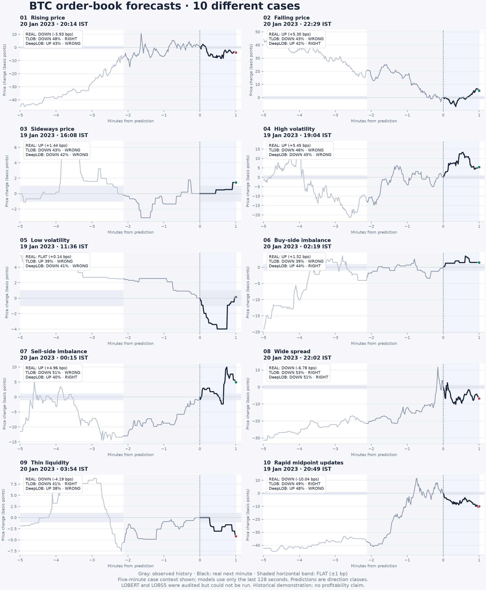

# BTC order-book model comparison

TLOB ranks first among the two runnable models by full-test balanced accuracy (35.24%). The strongest simple baseline, Depth imbalance, scores 37.09%. The top model does not beat the strongest baseline. There is no tested winner across all four: LOBERT and LOBS5 have no comparable results.

## What was actually tested

Real BTCUSDT perpetual L2 snapshots from January 9–20, 2023: 3,730,870 raw snapshots.
Training uses January 9–17; validation January 18; testing January 19–20.
Both published architectures were trained from scratch for this new task with equal budgets:
8,000 training windows, three epochs, seed 42, Adam 0.0001 and 128 one-second states.
An epoch was selected using validation loss only. Published event-horizon checkpoints
were not used. This is a small architecture experiment, not a paper replication or a
claim about the best possible training of either model.

The prediction is the midpoint's direction **60 seconds ahead**, with movements
within ±1 basis point counted as flat. One basis point is 0.01%, about $2.10 at
$21,000. This is neither trade-price OHLC generation nor simulated trading.

All 10 examples use different rules and timestamps separated by at least ten minutes.
They were frozen before training and prediction, using past-only measurements.
Examples include trends, sideways movement, contrasting volatility, opposite book
imbalances, wider spreads, thin depth and rapid midpoint updates. Market properties
can coexist. The snapshot recording rate is nearly fixed, so the activity case uses
observed midpoint changes, not a fabricated exchange-message count.

## Results

| Model | Status | Right in 10 cases | Full-test accuracy | Balanced accuracy | Macro F1 |
|---|---|---:|---:|---:|---:|
| TLOB | Trained and tested | 4/10 | 39.92% | 35.24% | 0.279 |
| DeepLOB | Trained and tested | 4/10 | 39.29% | 34.16% | 0.328 |
| LOBERT | Unavailable | — | — | — | — |
| LOBS5 | Unavailable | — | — | — | — |

Full test contains 2,367 eligible minute decisions.
Actual labels: {"up": 963, "flat": 456, "down": 948}.
Balanced accuracy gives equal weight to each class; always predicting the most
common class can inflate ordinary accuracy. Raw model probabilities are not calibrated.

| Baseline | Full-test accuracy | Balanced accuracy |
|---|---:|---:|
| Always flat | 19.26% | 33.33% |
| Training majority | 40.68% | 33.33% |
| Past-minute momentum | 38.23% | 35.50% |
| Depth imbalance | 44.91% | 37.09% |

## The 10 cases

| Case | Actual next minute | TLOB | DeepLOB |
|---|---|---|---|
| Rising price | DOWN | TLOB: DOWN 48% · RIGHT | DeepLOB: UP 43% · WRONG |
| Falling price | UP | TLOB: DOWN 43% · WRONG | DeepLOB: UP 42% · RIGHT |
| Sideways price | UP | TLOB: DOWN 43% · WRONG | DeepLOB: DOWN 42% · WRONG |
| High volatility | UP | TLOB: DOWN 46% · WRONG | DeepLOB: DOWN 45% · WRONG |
| Low volatility | FLAT | TLOB: UP 39% · WRONG | DeepLOB: DOWN 41% · WRONG |
| Buy-side imbalance | UP | TLOB: DOWN 39% · WRONG | DeepLOB: UP 44% · RIGHT |
| Sell-side imbalance | UP | TLOB: DOWN 51% · WRONG | DeepLOB: UP 40% · RIGHT |
| Wide spread | DOWN | TLOB: DOWN 53% · RIGHT | DeepLOB: DOWN 51% · RIGHT |
| Thin liquidity | DOWN | TLOB: DOWN 41% · RIGHT | DeepLOB: UP 38% · WRONG |
| Rapid midpoint updates | DOWN | TLOB: DOWN 49% · RIGHT | DeepLOB: UP 48% · WRONG |

Black lines show the actual next-minute path. Predicted classes and probabilities
are written on each chart; no exact price path was generated by these classifiers.
The detailed charts include probability bars for all three classes.

## All four requested models accounted for

- **TLOB:** actual published source, pinned revision `f1c0af4d81067978914361766db0457a7d8b6a46`.
  Trainable model definitions loaded without plotting/tracking side effects. BiN
  mixing weights are clamped positive to avoid its CUDA-only parameter replacement
  branch on this CPU. The network configuration is preserved.
- **DeepLOB:** actual original-author PyTorch notebook class, extracted without
  executing notebook training/download cells. Added channel axis; native softmax
  trained with log-probability loss. Window length adapted to 128 states.
- **LOBERT:** No official downloadable source/weights identified in paper and author sources. Not replaced by unrelated low-rank LoBERT NLP repository.
- **LOBS5:** Author code inspected. Requires individual-order L3 messages and order references; BTC dataset has only aggregate L2 snapshots. No BTC-trained checkpoint identified. Author source also pins CUDA-era JAX/Torch, unavailable as specified on this ARM Mac.

The original DeepLOB repository's FI-2010 weights are not BTC training. TLOB does
publish BTC TLOB/DeepLOB checkpoints, but their event-count target is a different
task from this one-minute benchmark. Downloaded checkpoints are retained separately.
No arbitrary checkpoint objects were deserialized to run this experiment.

## Limits

- Two of four requested models could be scored; there is no four-model winner.
- Fresh task-specific training; not scores of published pretrained checkpoints or paper replications.
- Midpoint direction, not complete OHLC or executable trade-price prediction.
- Ten selected extreme cases are illustrative and not a random accuracy sample.
- Short historical period, one seed, one training budget; no general superiority established.
- Adjacent minute outcomes/context are dependent; no independent-sample significance claim.
- No fees, spread-crossing execution, latency, slippage or profitability tested.
- Observed test period cannot be treated as untouched after results are inspected.
- Dataset venue is not independently certified; quantities are reported source units. Gaps are rejected, never filled.

Sources: [TLOB](https://github.com/LeonardoBerti00/TLOB), [original DeepLOB](https://github.com/zcakhaa/DeepLOB-Deep-Convolutional-Neural-Networks-for-Limit-Order-Books), [LOBERT paper](https://arxiv.org/abs/2511.12563), [author project](https://www.tuni.fi/fi/tau/tutkimus/ai-lob-advanced-limit-order-book-modeling-ai), [LOBS5](https://github.com/GereonFranken/LOBS5), [BTC dataset](https://www.kaggle.com/datasets/siavashraz/bitcoin-perpetualbtcusdtp-limit-order-book-data).
